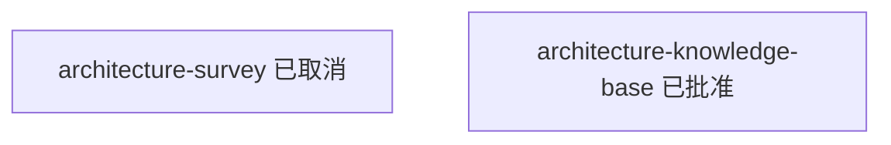

# 任务

## 工作树

- architecture-knowledge-base@1 [executable]：续做 game_rendering 架构知识库（首次委派因 reader timeoutMs=900000 超时全部失败，但范围 A/B 的报告已从会话留存中回收，证据完整可用）。本轮：派发 2 个 reader 分别补齐「ui/ 表现层」与「tests/+CI/pyproject 质量守护」两块缺口（切分更小、超时已提高到 2700000ms）；随后派发 1 个 worker 把 A/B/C1/C2 四份报告汇总成 docs/ARCHITECTURE.md（8 章节）；最后派发 1 个 reviewer 逐条核对证据与冲突。Main Agent 只做调度与编排，不亲自读代码、不亲自写文档正文。；已批准
- architecture-survey@1 [executable]：建设 game_rendering 架构知识库：派发 3 个 reader 子 Agent 对 core/agents/ui/scripts/tests 四个层做互斥模块的只读调查，收集带 file:line 的代码证据，汇总产出 docs/ARCHITECTURE.md（8 章节），并由 reviewer 逐条核对证据与冲突。Main Agent 只做调度与编排，不亲自读代码、不亲自写文档正文。；已取消

## 依赖关系

- architecture-survey：无
- architecture-knowledge-base：无

