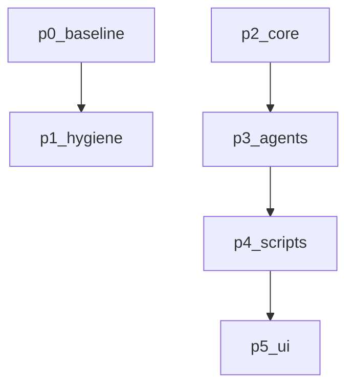

# 任务

- p0-baseline@1：Phase 0 基线核实：用 bash/grep 落定真实仓库清单、重复实现计数、阻塞点（time.sleep / threading.Timer / load_state_dict）全量位置、依赖与运行环境版本；为 D1/D2/D4/D6/D7 各产出可运行的复现脚本与实测输出，实测复核 D5 接线结论；产出 baseline_report.md，为后续「先红后绿」提供固定失败基线。；待批准；依赖 无
- p1-hygiene@1：执行 r3 已批准的仓库卫生与依赖锁定部分（不涉及 r5 的删除动作）：建立 .gitignore、将构建/模型产物从索引移除、建立 pyproject.toml 锁定依赖与工具配置、移除 sympy 误依赖、替换废弃 np.trapz、重写 README。；待批准；依赖 p0-baseline
- p1-cleanup-single-strategy@1：按人工决策 D-R5 执行单一策略清理：删除 15 个冗余策略脚本、mymath/robot.py 与整个 备份/ 目录，归档多余模型产物，修复因删除产生的坏引用，并在 CHANGELOG.md 逐项记录以便从 git 历史恢复。；已批准；依赖 无
- p2-core@1：建立 core/ 核心包（纯逻辑、无 pygame），以 TDD 方式修复 D1（看牌结算比较方向与 whose_turn）、D6（默认均匀发牌）、D2（rest_option 单调不减纳入契约）与 D4（结束后拒绝继续行动），用穷举 22100 手精确表替代 2000 次蒙特卡洛胜率，并让牌型判定与结算逻辑成为唯一实现。；已批准；依赖 无
- p3-agents@1：建立 agents/ 智能体层：BaseAgent 接口、可配置 DQN 模块（含按 checkpoint 实际维度构造的 from_checkpoint 工厂，修复 D8）与迁入的 Robot2 对手策略；让保留策略真正加载 dqn_model_1.pth 的 4 维权重并生效（修复 D9）。；已批准；依赖 p2-core
- p4-scripts@1：建立 scripts/ 训练与评估入口：参数化训练（回合/种子/设备/输出目录→run/）、无头对战评估、同种子逐位可复现；产物不进入 git。；已批准；依赖 p3-agents
- p5-ui@1：把 UI 重构为事件驱动、零阻塞的薄渲染层：可注入节奏器替代 time.sleep、非阻塞 poll_input 响应 QUIT、状态一律向 core 查询、资源路径集中管理；并让保留策略在真实显示下完整走完一局且 AI 使用已训练权重。；已批准；依赖 p4-scripts

