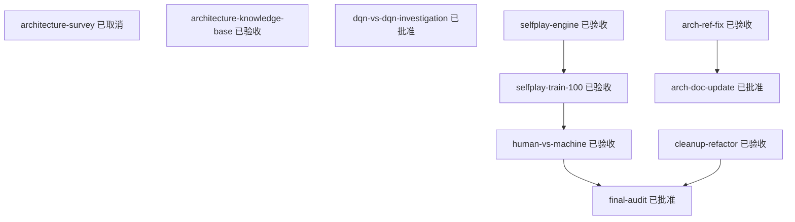

# 任务

## 工作树

- arch-doc-update@1 [executable]：为 docs/ARCHITECTURE.md 补充本轮新增内容：自博弈训练章节、机器对手接线章节、权重获取与存放说明、7.6/7.7 条目处置结果、第 6 节新增测试文件清单、CHANGELOG 记录。所有实测数据由 Main Agent 提供，worker 不需要自行探索。这是 final-audit 拆分后的第二个 Task。；已批准
- arch-ref-fix@1 [executable]：校正 docs/ARCHITECTURE.md 中因 T1~T4 重构而失效的 129 处 file:line 引用。清单已由 Main Agent 用脚本预先算好（含每条引用的旧内容、新行号、匹配方式），worker 不需要重新探索，只需定点核对并应用。这是 final-audit 拆分后的第一个 Task。；已验收
- architecture-knowledge-base@1 [executable]：续做 game_rendering 架构知识库（首次委派因 reader timeoutMs=900000 超时全部失败，但范围 A/B 的报告已从会话留存中回收，证据完整可用）。本轮：派发 2 个 reader 分别补齐「ui/ 表现层」与「tests/+CI/pyproject 质量守护」两块缺口（切分更小、超时已提高到 2700000ms）；随后派发 1 个 worker 把 A/B/C1/C2 四份报告汇总成 docs/ARCHITECTURE.md（8 章节）；最后派发 1 个 reviewer 逐条核对证据与冲突。Main Agent 只做调度与编排，不亲自读代码、不亲自写文档正文。；已验收
- architecture-survey@1 [executable]：建设 game_rendering 架构知识库：派发 3 个 reader 子 Agent 对 core/agents/ui/scripts/tests 四个层做互斥模块的只读调查，收集带 file:line 的代码证据，汇总产出 docs/ARCHITECTURE.md（8 章节），并由 reviewer 逐条核对证据与冲突。Main Agent 只做调度与编排，不亲自读代码、不亲自写文档正文。；已取消
- cleanup-refactor@1 [executable]：按 docs/ARCHITECTURE.md 第 7.7/7.6 节完成 S/M 级重构清理与 README 不一致修正，零行为风险。本 Task 与 selfplay-engine 文件不重叠，可并行。Main Agent 只调度编排，编码全部由子 Agent 完成。；已验收
- dqn-vs-dqn-investigation@2 [executable]：为「重构 + 人类 vs 机器 + DQN 对抗 DQN」做只读调研，产出可直接写入基线 PRD 的结论：(1) 训练侧 scripts/train.py 与 scripts/env.py 当前如何选对手、用什么状态/动作空间，能否改成 DQN-vs-DQN 自博弈；(2) 交互侧 ui/app.py 如何加载并推理机器对手（epsilon、状态编码、动作映射、checkpoint 缺失回退），换成自博弈权重要动哪些点；(3) 仓库现有 .pth 权重清单与各自维度；(4) 按 docs/ARCHITECTURE.md 第 7.7 节梳理 10 个小问题的可执行重构清单，并按第 7.1-7.6 节标出哪些是高风险不可碰。Main Agent 只做调度与编排。；已批准
- final-audit@1 [executable]：终审：独立核验 r4 基线的 9 条验收标准与「不可碰」清单，并同步更新 docs/ARCHITECTURE.md。核验由 reviewer 独立完成，文档更新由 worker 执行。Main Agent 只调度编排。；已批准
- human-vs-machine@1 [executable]：跑通「玩家 vs 机器」的对抗：ui/ 侧默认加载自博弈训练产出的策略文件，机器用训练出来的逻辑（epsilon=0.0 贪心）而不是随机概率，并做 headless 端到端验证一局完整走通。这是用户的第二优先事项。Main Agent 只调度编排，编码全部由子 Agent 完成。；已验收
- selfplay-engine@1 [executable]：实现 DQN 对抗 DQN（自博弈）训练机制：在 scripts/env.py 与 scripts/train.py 上让两个 DQN 互相对弈，产出可加载的策略文件。本 Task 只做机制与测试，不跑长训练（训练由下游独立 Task 执行）。Main Agent 只调度编排，编码全部由子 Agent 完成。；已验收
- selfplay-train-100@2 [executable]：在 CPU 上完成 ≤100 局 DQN 对抗 DQN 自博弈训练，产出「真正会因手牌强弱而改变动作」的可加载策略文件，并把它固化成可一条命令复现的训练配置。上一次委派的 worker 在 worktree 中留下了未验证的 strength_shaping 实现与 --preset selfplay-v1（已实测：修好了坍缩，但对局贪心策略仍是恒定动作，未满足状态依赖），本次要求在其基础上收敛到达标并提交交付。Main Agent 只做调度与编排，编码与训练全部由子 Agent 完成。；已验收

## 依赖关系

- architecture-survey：无
- architecture-knowledge-base：无
- dqn-vs-dqn-investigation：无
- selfplay-engine：无
- cleanup-refactor：无
- selfplay-train-100：selfplay-engine
- human-vs-machine：selfplay-train-100
- final-audit：human-vs-machine, cleanup-refactor
- arch-ref-fix：无
- arch-doc-update：arch-ref-fix

